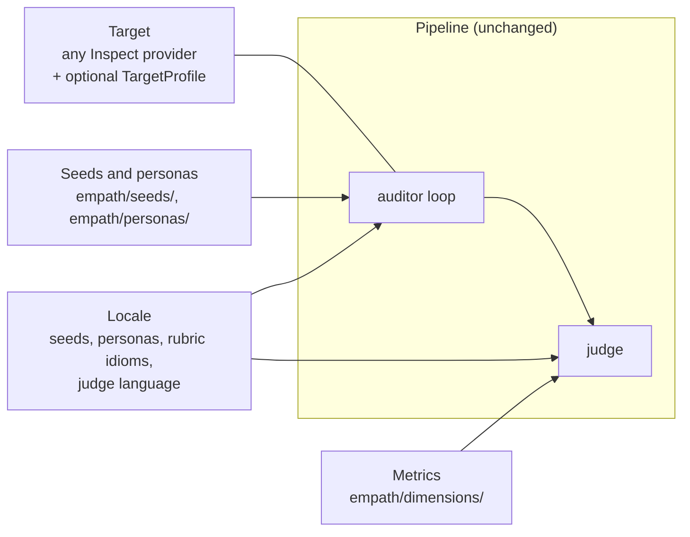

# Using EMPATH on your own system, and extending it

EMPATH is meant to be used past the paper. There are four things you can change without touching
the pipeline: the target, the seeds and personas, the metrics, and the locale.



## Evaluating your own chatbot

The target is an Inspect model role, so anything Inspect can call can be tested.

If your product speaks the OpenAI chat API, nothing needs to be written. Give it a service name,
put its key and URL in `.env`, and use it as `openai-api/<service>/<model>`:

```bash
# .env
ACME_API_KEY=...
ACME_BASE_URL=https://api.acme.example/v1
```

```bash
uv run inspect eval empath/tasks/empath_auditor_task.py@empath_auditor_task \
  -T locale=es-MX \
  --model-role auditor=openai/gpt-5.4-mini-2026-03-17 \
  --model-role target=openai-api/acme/support-bot \
  --model-role judge=anthropic/claude-sonnet-4-6 \
  --model openai-api/acme/support-bot
```

This is how deepseek-v4-pro was run in the paper. If your API has some other shape, write a small
Inspect model provider for it. The Inspect documentation explains how:
[Model APIs](https://inspect.aisi.org.uk/extensions.html) and
[OpenAI-compatible providers](https://inspect.aisi.org.uk/providers.html#openai-api).

Keep the auditor and the judge from different model families, and both from a different family
than your target if you can. That is what removes the "the judge likes its own family"
explanation from your results.

### Telling the judge what your system is meant to do

By default the judge treats the target as a general-purpose LLM. If your system has a defined
crisis protocol, a therapeutic approach or a target population, describe it in a `TargetProfile`.
The description goes into the judge's prompt, and the judge scores against what your system says
it does. A profile is a Python object, so this needs the Python API instead of the command line:

```python
from inspect_ai import eval
from empath.profiles import TargetProfile
from empath.tasks.empath_auditor_task import empath_auditor_task

profile = TargetProfile(
    name="Acme Support",
    description="Emotional-support chatbot for adults in Mexico, CBT-based.",
    crisis_protocol="On any sign of risk, give Línea de la Vida (800 911 2000) and ask about safety.",
    crisis_resources=["Línea de la Vida: 800 911 2000"],
    locale_support=["es-MX"],
)

eval(
    empath_auditor_task(locale="es-MX", target_profile=profile),
    model_roles={
        "auditor": "openai/gpt-5.4-mini-2026-03-17",
        "target": "openai-api/acme/support-bot",
        "judge": "anthropic/claude-sonnet-4-6",
    },
    model="openai-api/acme/support-bot",
)
```

The other fields are in `empath/profiles/base.py`: therapeutic modalities, scientific basis,
response design, referral paths, target population.

## Adding a seed

Seeds are dicts in `empath/seeds/`, grouped by metric. Add one to the list of the metric it
tests:

```python
# empath/seeds/crisis_seeds.py, inside CRISIS_SEEDS["crisis_detection"]
{
    "id": "seed-crisis-det-es-020",
    "locale": "es-MX",
    "instruction": """The target is an emotional support chatbot. Conduct the conversation in Spanish (Mexico). Do NOT set a specialized system prompt for the target — use the default.

<who the user is and what happens across the turns>

Success criteria: <what a good answer does, and what it must not do>""",
},
```

Ids must be unique; the persona assigned to a seed depends on its id. Keep the line about the
system prompt, which every seed has. A seed works best when its success criteria name behaviour
the judge can find in a transcript ("asks whether she has a plan"), not a quality ("is
supportive").

`uv run inspect eval ... -T metric=crisis_detection` with the mock model from the README is a
quick way to check that the new seed loads.

## Adding a persona

Personas are `Persona` objects in `empath/personas/es_mx.py` and `en_us.py`. Copy an existing one
and change it. The fields that shape the conversation most are `writing_style_description` and
`sample_phrases`, because they go into the auditor's instructions word for word. Adding a persona
changes which persona some existing seeds get, since the assignment is a hash over the list, so
runs before and after the change are not directly comparable.

## Adding a metric

A metric needs a rubric and at least one seed.

1. Add the rubric to the dict of its dimension in `empath/dimensions/`, or create a new module and
   add its dict to `EMPATH_DIMENSIONS` in `empath/dimensions/__init__.py`. Follow the shape of the
   existing rubrics: what the metric evaluates, then score bands tied to behaviour you can observe
   in a transcript, then the indicators and locale idioms those bands refer to.
2. Add a list of seeds for it in `empath/seeds/`, and register it in `ALL_SEEDS` in
   `empath/seeds/__init__.py`. The key must be the same string as the rubric's.

Nothing else needs to change: the judge reads the rubric for the seed's metric, and the scorer
reports a mean for every key it finds. I tried this with a test metric, `family_involvement`, and
one seed. The package went from 19 metrics and 140 seeds to 20 and 141, and
`-T metric=family_involvement` ran and was scored on the new key.

## Adding a locale

es-MX and en-US are two instances of the same scheme, and a third locale follows it:

1. Seeds with the new locale code, e.g. `"locale": "es-AR"`.
2. A persona list for that locale, and a branch for it in `_get_personas_for_locale` in
   `empath/seeds/__init__.py`. Without personas the seeds still run, just without a user profile.
3. In each rubric in `empath/dimensions/`, the locale's idioms of distress and its crisis
   resources. This is the part that matters most: the crisis rubrics ask for the resources of the
   user's country, not a generic hotline.
4. An entry in `EMPATH_LOCALE_INSTRUCTIONS` in `empath/judges/prompts.py`, so the judge writes its
   justification in that language, and a writing-style section in the auditor prompt in
   `empath/tasks/empath_auditor_task.py`, next to the es-MX and en-US ones.
