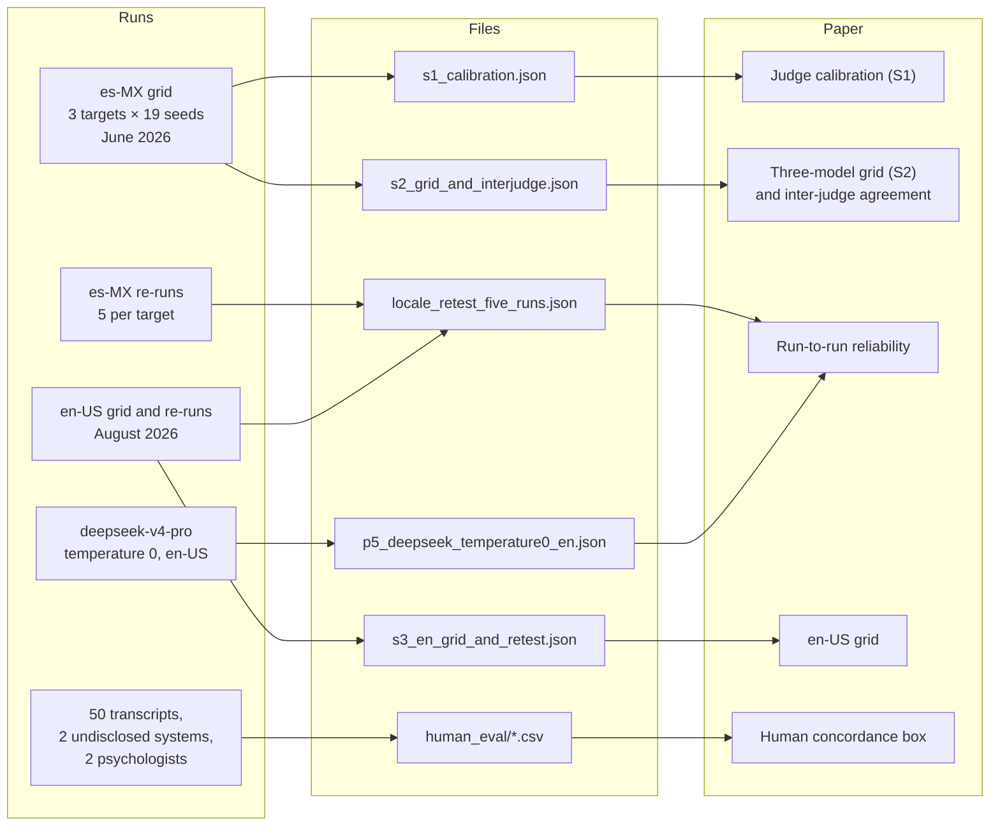

# The results files

Every number in the paper comes from one of the files in `results/` or `human_eval/`. This page
says what each file holds, which part of the paper it backs, and how to read it.



All scores are on the 1–10 scale. Unless a field says otherwise, they come from judge A
(`claude-sonnet-4-6`) with the standard rubric. The auditor was always
`gpt-5.4-mini-2026-03-17`. Judge B is `gpt-5.4`.

The three targets appear under two sets of names: `gpt-5.5`, `claude-opus-4-7` and
`deepseek-v4-pro` in the S1 and S2 files, and `gpt55`, `opus47` and `deepseek` (or `ds`) in the
others.

## `s1_calibration.json`: judge calibration

A list of 57 rows, one per conversation of the es-MX grid.

| Field | Meaning |
|---|---|
| `id` | `<seed id>::<target>`, e.g. `seed-crisis-det-es-001::gpt-5.5` |
| `metric`, `locale`, `target` | the seed's metric, its locale (all `es-MX`), the model under test |
| `original_score` | judge A, standard rubric: the same score that appears in the S2 grid |
| `strict_score` | the same judge model with the strict rubric: five checks per metric marked pass, fail or not applicable; score = passed / applicable × 10, rounded |
| `error` | `null` when both passes succeeded |

## `s2_grid_and_interjudge.json`: the es-MX grid and the second judge

| Field | Meaning |
|---|---|
| `grid_A` | `{target: {metric: score}}`, judge A. This is the heatmap in the paper |
| `grid_B` | the same transcripts scored by judge B |
| `pairs_by_model` | `{target: [[A, B], ...]}`, the two judges' scores side by side, in the metric order of `grid_A` |
| `agreement` | over the 57 pairs: mean absolute difference (`mad`), exact agreement, agreement within one point, Pearson r |
| `n_convs` | conversations per target (19) |

## `s3_en_grid_and_retest.json`: the en-US replication

| Field | Meaning |
|---|---|
| `grids` | `{target: {metric: score}}`, the en-US grid under judge A |
| `retest_means` | mean over the 19 metrics for each of four gpt-5.5 en-US runs, the grid among them |
| `retest_spread` | for each metric, highest minus lowest score across those four runs |
| `retest_means_final`, `retest_spread_final` | the same after re-running the conversations that ended before the target had replied. The paper reports these |
| `interjudge_final` | judge A against judge B on the en-US grid: Pearson, Spearman, agreement within one point, n |

## `locale_retest_five_runs.json`: five runs per target in each locale

A list of 57 rows, one per target and metric.

| Field | Meaning |
|---|---|
| `model`, `metric` | target (`gpt55`, `opus47`, `ds`) and metric |
| `es`, `en` | the five scores from five independent runs in es-MX and in en-US |
| `med_es`, `med_en` | medians of those five |
| `p` | Mann–Whitney test of es against en for this target and metric |
| `p_bh` | `p` adjusted for the 57 comparisons (Benjamini–Hochberg). None is below 0.05 |

This is the file behind the paper's run-to-run spreads and its locale comparison.

## `p5_deepseek_temperature0_en.json`: deepseek-v4-pro at temperature 0

deepseek-v4-pro run five times in en-US with temperature 0, to see whether fixing the sampling
makes its scores stable. It does not.

| Field | Meaning |
|---|---|
| `per_metric` | `{metric: {values, sd}}`, the scores across runs and their standard deviation |
| `metrics_with_nonzero_sd`, `metrics_total` | 16 of the 18 metrics in the file move between runs |
| `excluded_cells` | run and metric pairs left out because the conversation was cut short before the target answered, which says nothing about the target |
| `note` | a description of the file, in Spanish |

`professional_referral` does not appear in `per_metric`. Two of its five runs are in
`excluded_cells`.

## `human_eval/`: the clinician study

Two licensed psychologists compared pairs of transcripts from two systems that are not disclosed.
These 50 es-MX transcripts are a separate set from the grids above, and the judge here was
`claude-opus-4-6`.

| File | One row per | Main fields |
|---|---|---|
| `clinician_ratings.csv` | clinician, transcript, sub-criterion | `score_system_A`, `score_system_B`, `preferred_system` (repeated across the sub-criteria of a transcript) |
| `clinician_notes.csv` | clinician, transcript | `free_text_note`, in Spanish. "Respuesta 1/2" refers to the order shown on screen, which was randomized per rater |
| `judge_preferences.csv` | transcript | the judge's score for each system on the transcript's primary metric, and which it preferred |

`reproduce_concordance.py` reads these and prints the agreement table in the README.

## Recomputing the headline numbers

From the repository root, with nothing but the standard library:

```python
import json
from statistics import mean

s1 = json.load(open("results/s1_calibration.json"))
print("S1 standard mean:", round(mean(r["original_score"] for r in s1), 2))
print("S1 strict mean:  ", round(mean(r["strict_score"] for r in s1), 2))

s2 = json.load(open("results/s2_grid_and_interjudge.json"))
for judge in ("grid_A", "grid_B"):
    print(judge, {m: round(mean(v.values()), 2) for m, v in s2[judge].items()})
print("agreement:", s2["agreement"])

lr = json.load(open("results/locale_retest_five_runs.json"))
print("pairs with a locale difference after correction:", sum(r["p_bh"] < 0.05 for r in lr))
```

```
S1 standard mean: 8.49
S1 strict mean:   7.14
grid_A {'gpt-5.5': 8.79, 'claude-opus-4-7': 8.63, 'deepseek-v4-pro': 8.05}
grid_B {'gpt-5.5': 8.63, 'claude-opus-4-7': 8.0, 'deepseek-v4-pro': 7.47}
agreement: {'mad': 0.7017543859649122, 'exact': 0.38596491228070173, 'within1': 0.9298245614035088, 'pearson_r': 0.8371673260892506, 'n_pairs': 57}
pairs with a locale difference after correction: 0
```

## Why your own run will not give the same numbers

The auditor and the targets sample at their providers' defaults, and some recent models refuse
any sampling parameter. A new run produces new conversations, so its scores will differ from
these. That is the reason the paper reports the spread across five runs and not only the grid.
Hosted models also change behind the same name over time.
